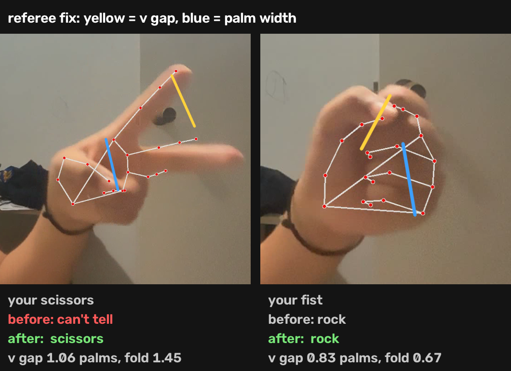
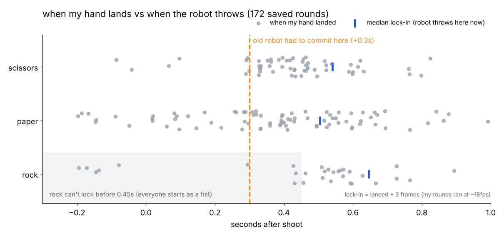
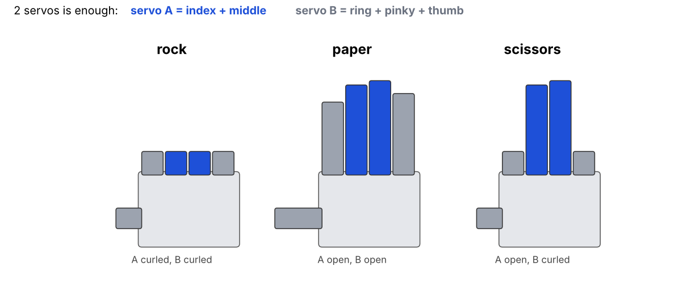
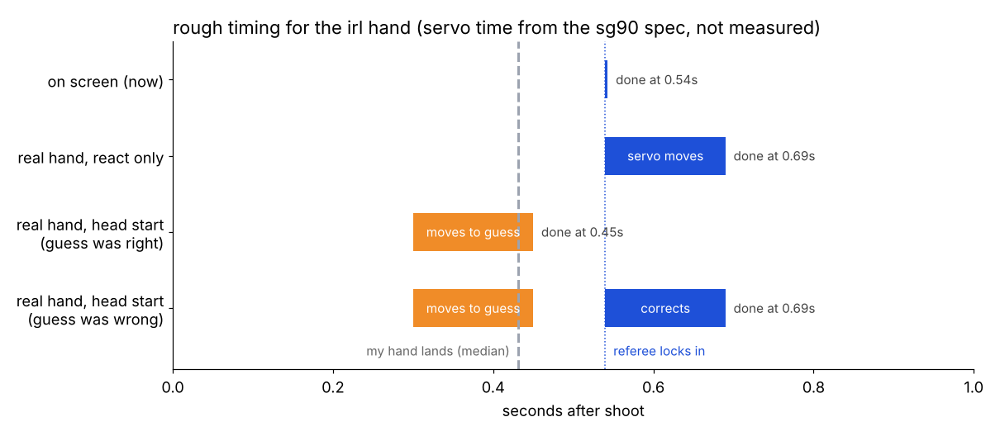

# lilrps journal

## 31 oct 2026: teaching it to see scissors head-on

lilrps couldn't read scissors when i pointed my fingers at the camera. it was also just generally shaky at finding my hand. so today was about working out why, then fixing it.

### why it breaks

the referee decides each finger is straight or curled by comparing how far the tip is from the wrist vs how far the middle knuckle is. that works side-on. but the camera only sees a flat picture. when a finger points straight at the lens, the tip lands right on top of the knuckle, so a straight finger looks exactly as short as a curled one. my V turned into rock.

i went back through all my saved rounds to check. on the most head-on scissors frames the tip/knuckle ratio was about 1.02, under my 1.1 cutoff. even side-on, only 73% of my scissors frames read correctly after my hand had stopped moving, because my thumb covers my ring and pinky and mediapipe guesses they're straight (28 frames got called paper).

### fix 1: look at the gap in the V

even head-on, you can still see two fingertips spread apart. so now if the gap between my index and middle tips is more than 0.8 palm widths, it's scissors.

first version was bad. while making screenshots i found it calling 13 of my fists scissors, because mediapipe squashes fist fingertips apart. added one more check: the V only counts if those fingertips aren't folded back toward the wrist (a curled finger's tip comes back toward the wrist, a straight one pointed at the camera doesn't). that killed all 13. scissors frames went 73% -> 85%, rock and paper didn't move.

### fix 2: the predictor had the same blind spot

the model that guesses my throw early scaled every hand by the wrist-to-knuckle length. head-on that length shrinks and the numbers blow up into stuff it's never seen. now it scales by palm width too, which stays the same head-on. it also trains on copies of every round rotated up to 70 degrees toward the camera, so it's seen something like a head-on hand.

retrained on 155 rounds. after my hand lands it's still 85%. on rounds tilted 60 degrees toward the camera it went 59% -> 84%. it's using mediapipe's depth guess to fake the tilt though, so this still needs testing on real head-on throws.

also added a brightness number to the debug line that goes red when it's too dark, because dim light = longer shutter = blurry hand = mediapipe drops it.

### the real problem

it still couldn't do head-on scissors live. so i took a screenshot mid-throw and ran it through mediapipe with tracking off, meaning it has to find the hand from scratch. no hand found. not with the lite model, not with the full model, not even with the confidence bar at 5%.

so the skeleton i was seeing was leftover tracking. mediapipe locks onto my fist during the countdown, and when i turn my fingers toward the lens it keeps fitting a hand into the same box. it fits the shape it knows best, a fist. every rule i'd written was reading a fake fist. you can't fix bad points with better rules.

### fix 3: read pixels instead of points

new plan: stop trusting the points, just use them to find where the hand roughly is.

camera -> mediapipe points -> square box 2.2x bigger than the points (so it still covers my fingers when the points are squashed into a corner) -> 112x112 crop -> small cnn -> rock / paper / scissors + how sure it is

- `hand.py`: the box (smoothed, held for 1 second if mediapipe loses the hand), the crop, and the cnn. 4 conv layers, about 190k weights, tiny enough for my laptop.
- `collect.py`: hold a move, press r / p / s, and it saves every frame's crop for 4 seconds. move your hand around while it records.
- `train_crops.py`: trains with random rotation, zoom, shift, mirror, blur and brightness. it tests on whole bursts it never trained on, because frames inside one burst are basically copies and splitting by frame would cheat.
- `play.py` uses the classifier as the referee once it's trained, and saves 6 crops from every round so playing keeps growing the dataset.

hit a batchnorm bug on the way. on 18 test images it got 100% in training mode and 39% in eval mode on the same images. batchnorm keeps a running average to use at play time, and it only moves 10% per step, so it was lagging behind the weights. fixed it by running 30 batches through before scoring, which took it to 83%.

### next

collect real crops (about 8 bursts per move, with head-on ones for every move so it doesn't just learn head-on = scissors), train it, and see if it finally gets my head-on scissors. after that the early guess should move to pixels too, because right now it still runs on mediapipe points.

## 1 nov 2026: making it always win (and planning the real one)

the referee finally works. resnet18 reads my rock, paper and scissors live, head-on included. which made me realise something kinda dumb: if the referee already knows what i threw, why is the robot still guessing?

### cheating (legally)

up to now the robot had to commit 0.3s after shoot, using a small model on mediapipe points. it was good on my hand, but it was still a guess, and guesses lose sometimes.

there's a robot from the ishikawa lab at the university of tokyo that wins rock paper scissors every single time. it doesn't predict anything. it watches your hand with a really fast camera and reacts before your brain can notice. so i did that.

now the robot waits for the referee to lock in your move and throws the counter on that same frame. its move comes straight from the referee's call, so the only way it loses is if the referee reads your hand wrong.

the early guess still runs. the result screen shows when the robot locked in and what the keypoint guess would've thrown, so i can still see if the prediction side is any good. `--predict` (or `?predict` on the browser version) puts the old mode back.

one catch: rock. everyone's hand starts as a fist, so the referee won't call rock until 0.45s after shoot. against rock the robot's paper shows up late enough that you might notice. paper and scissors lock 2 frames after your hand lands. my saved rounds ran at about 18fps, so that's roughly 110ms, which is way harder to see.

### the irl one

on screen, reacting is free. a real hand has to actually move. a cheap sg90 servo turns about 60 degrees in 0.1s, so going fist -> open hand adds roughly 150ms on top of the camera. that's slow enough to look like it's reacting, so every idea below is really about that.

**tendon hand, 2 servos.** printed fingers, fishing line to the servo, elastic pulls them back open. servo A does index + middle, servo B does ring + pinky + thumb. both curled = rock, both open = paper, A open and B curled = scissors. cheap and looks like a real hand, but the string stretches and it needs a lot of tuning.

**linkage fingers, 2 servos.** same 2 groups, but each finger is a rigid 4-bar linkage driven straight off the servo. no string, no elastic, same pose every time. more cad work, but probably the best one for this.

**spinning wheel, 1 servo.** a 3-sided thing with a fist, palm and V on it that turns to the right face. worst case is 120 degrees and nothing can jam. looks like a toy, but it'd be a quick way to test the timing before building fingers.

**full 5 servo hand.** one servo per finger. way more wiring and power for the same 3 moves, and it doesn't fix the speed. nah.

the brain stays on my mac (resnet18 is about 4ms a frame there). play.py sends one byte over usb serial to a pico that moves the servos. chrome can talk to serial devices too, so the browser version could drive it.

### making it fast

starting the countdown half curled means no move is ever a full sweep. faster micro servos help too, some are around 0.06s per 60 degrees. but the real fix is bringing the early guess back as a head start: at +0.3s the hand starts moving toward the guess, then when the referee locks in it corrects if the guess was wrong. most rounds it's already there by the time it needs to be.

prediction gets it moving early, reaction makes sure it's right. that's the plan.

### next

play a bunch of rounds to check the lock times, then cad the two finger groups.
