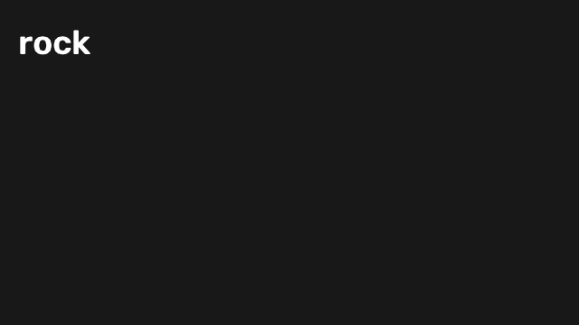
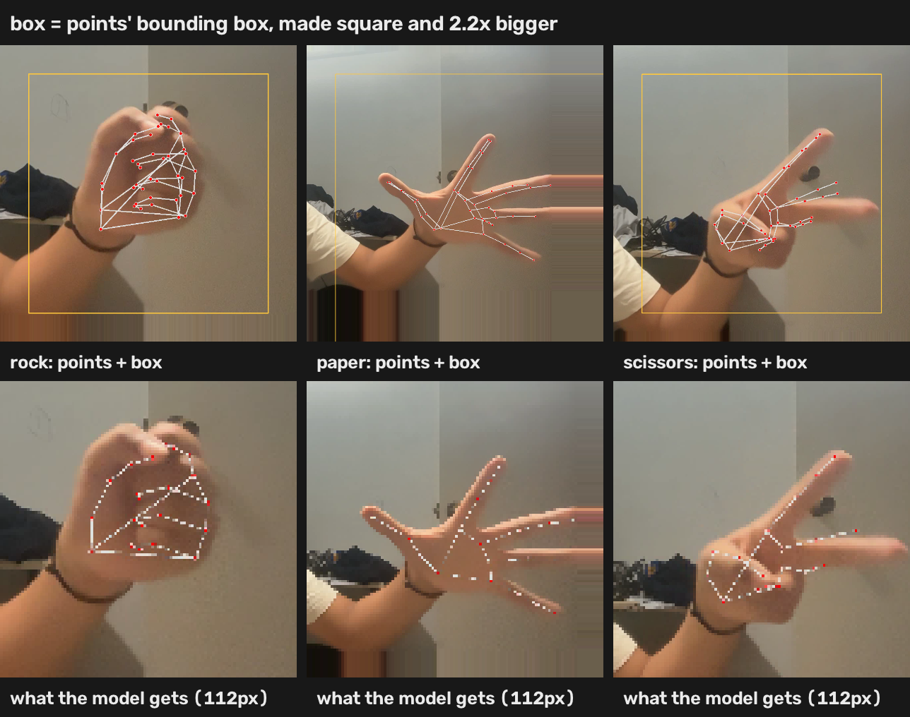
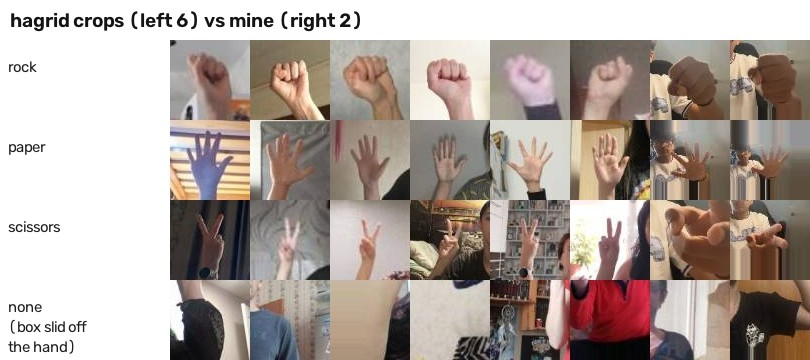
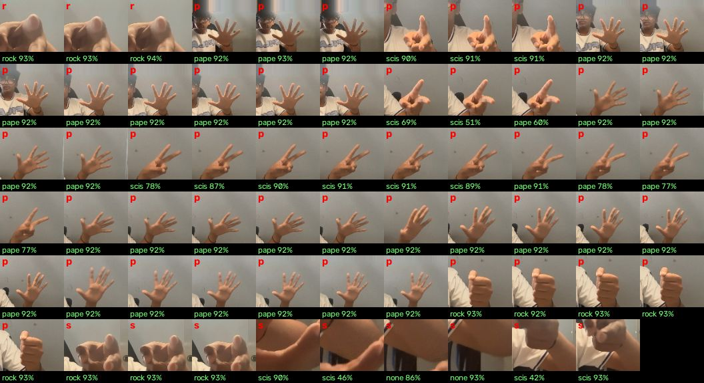
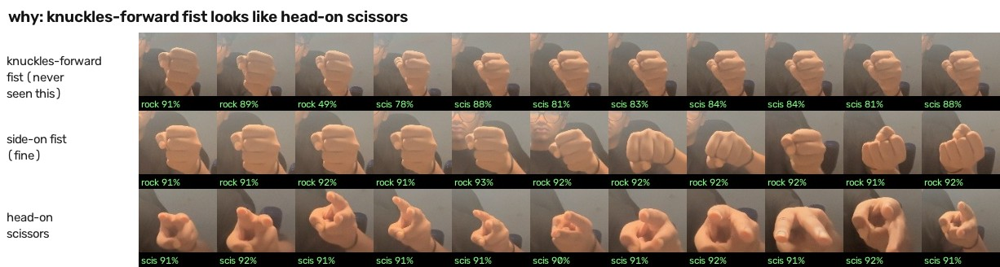
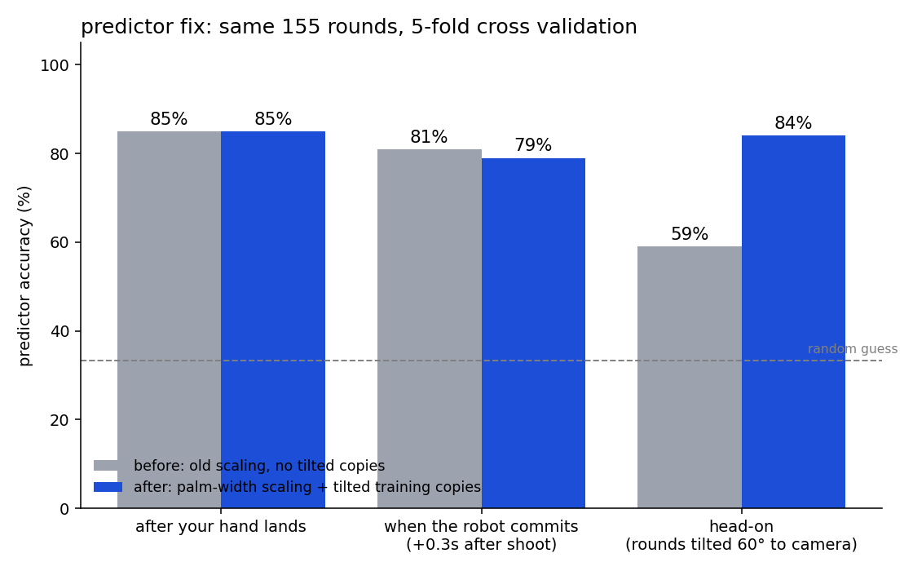

# lilrps

a rock paper scissors robot that reads ur hand before u even finish throwing. (building it for fallen, hack club)

**play it in ur browser: [navthings.github.io/lilrps/web](https://navthings.github.io/lilrps/web/)** (same models, runs on ur webcam, nothing gets uploaded. the setup below is for the full mac version that saves rounds)



*thats what the robot actually sees, 21 dots on my hand. the blue move is the robot locking in 0.3s after shoot, usually before my hand has even finished landing*

## what it does

mac webcam -> mediapipe (the google hand thingy) finds 21 points on ur hand -> a tiny model guesses ur move from the first few frames -> robot throws whatever beats it

trained on 82 rounds of my hand, it reads my throw like 0.2s before it lands and beat me 11 out of 11 live on rounds it had never seen. lost to my own robot 11 times in a row. kinda embarassing tbh

## setup

```
uv venv -p 3.12 .venv && uv pip install -p .venv -r requirements.txt
```

## play

```
.venv/bin/python play.py
```

run it from apple terminal or macos wont ask for camera permission (learned that the hard way). space starts a round, throw on "shoot!"

after each round it tells u what u threw. if its wrong press r / p / s to fix it, x bins the round, space saves it and goes again. d hides the debug line, q quits

flags:
- `--cutoff 0.3` how many seconds after shoot the robot has to commit. lower = harder for it
- `--random` robot ignores the model and just throws random
- `--rules` referee uses the old finger rules instead of the hand classifier
- `--player name` tags rounds with whose hand it is
- `--record` saves the session as a video in clips/

every round gets saved, so playing = collecting data. 2 birds 1 stone

## how it works out what u threw

v1 was no ml at all, just geometry. a finger counts as straight if its tip is further from ur wrist than its middle knuckle. ring + pinky both straight = paper, both curled = rock or scissors, and index/middle decide which

then i found out scissors doesnt work head on asdfjkl. a finger pointing straight at the camera looks exactly as short as a curled one, so my V turned into rock. added a check for the gap between the index and middle tips (more than 0.8 palm widths = V) and scissors went 73% -> 85% on my saved rounds. the first version called 13 of my fists scissors lol so now the V only counts if those tips arent folded back toward ur wrist

then i found the ACTUAL problem. mediapipe doesnt even SEE a hand head on. ran a screenshot through it with tracking off and it found nothing, even at 5% confidence. the skeleton i was seeing was just leftover tracking from my fist, so every rule i wrote was reading a fake fist. u cant fix bad points with better rules. i HATE mediapipe

## hand classifier (reading pixels instead of points)

so now mediapipe only gets to find roughly where ur hand is:

mediapipe points -> square box 2.2x bigger than the points -> 112x112 crop -> small cnn (mlx) -> rock / paper / scissors + how sure it is



```
.venv/bin/python collect.py
```

hold a move, press r / p / s and it saves every frames crop for 4 seconds into data/crops/. move ur hand around while it records: tilt it, go head on, near and far. like 8 bursts per move

```
.venv/bin/python train_crops.py
```

trains with random rotate / zoom / shift / mirror / blur / brightness, and tests on whole bursts it never saw (frames inside one burst are basically copies so splitting by frame would be cheating). once results/classifier.safetensors exists play.py uses it as the referee, and it only trusts answers its 60%+ sure of

### v2: pretrained resnet18 + other peoples hands

the small cnn only ever saw MY hand, held still, with a perfect box. so ofc it shit itself the second i actually played. so now its a resnet18 thats already seen imagenet, fine tuned on [HaGRID](https://github.com/ai-forever/hagrid) (a massive hand gesture dataset with tens of thousands of diffrent people) plus my crops weighted 3x. fist = rock, palm = paper, peace = scissors

theres also a 4th answer now, **none**. it learns it from boxes slid off the hand onto arms, shirts and walls, which is LITERALLY what my box does when mediapipe drops me. so instead of "rock 99%" on my arm it says "none" and the referee just waits

```
.venv/bin/python hagrid.py      # needs the 3.5gb hagrid-sample-120k-384p zip unzipped in data/hagrid/
.venv/bin/python train_r18.py   # ~20 min on an m5, writes results/classifier_r18.safetensors
.venv/bin/python train_r18.py --init --all --epochs 2 --lr 1e-4   # ~4 min, keeps training it after u record new bursts
uv run export_web.py            # puts the new model in the browser version (web/classifier_r18.onnx)
```

play.py uses classifier_r18 if it exists, otherwise the old small one. like 4ms a frame on an m5

| test | old cnn | resnet18 |
|---|---|---|
| hagrid people it never saw | - | 99.9% (1932) |
| my bursts it never saw | 100% | 100% (266) |



BUT last time i got 100% it was fake so i didnt trust it. went through the 65 crops play.py saved from real rounds and the LABELS were wrong lol. sideways scissors saved as paper, side fists saved as paper, my fucking ARM saved as scissors. they came from the old broken referee and i just kept spamming space. checked them by eye instead and its right on basically all of them



then i actually played it and it called my rock scissors. CONSTANTLY. 250 out of 415 fists. what. turns out a knuckles forward fist (curled fingers pointing at the camera) looks almost exactly like my head on scissors, and it had only ever seen side on fists. so it panicked. recorded fresh bursts (415 rock, 384 scissors, 356 paper), kept training on them, and now it works



the referee got a rule too: everyones hand starts as a fist, so a fist in the first 0.45s after shoot doesnt count yet. and paper or scissors needs 3+ frames and a third of the votes after shoot to beat rock, so a couple flickery frames cant flip ur rock into scissors

### the browser version

runs the same resnet18, turned into an onnx file (22mb, fp16 weights) and run with onnxruntime-web, webgpu if ur browser has it. no way im running a resnet in plain js. checked it gives the EXACT same answers as the mlx one on 40 crops

if it says it cant find ur camera, ur browser doesnt have camera permission (mac: system settings > privacy & security > camera, windows: settings > privacy & security > camera) or something else is using it. if ur pc cant do gpu stuff it falls back to cpu instead of dying

**status: rock, paper and scissors all work live, head on included. LETS GO.** next: save raw frames from real rounds so i can test the whole referee on them, not just crops

## the early guess

```
.venv/bin/python train.py
```

small mlx network that looks at the last 8 frames of hand points and guesses ur move. scored with 5 fold cross validation, so every round gets tested by a model that never trained on it. prints accuracy at every cutoff from 0.4s before shoot to 0.7s after and saves the charts + results/predictor.safetensors

it scales hands by palm width and trains on copies of every round tilted toward the camera (`--aug`, default 2) so head on hands dont totally break it. on rounds tilted 60 degrees it went 59% -> 84%. the tilt is faked from mediapipes depth guess tho, so its not real head on data



this one still runs on mediapipe points, so its still worse head on than the classifier

## tuning

if the referee keeps getting stuff wrong tweak STILL, UP_RATIO, SPREAD and FOLDED at the top of play.py. the debug line shows motion and brightness and goes red when its too dark, cuz dim light = blurry hand = mediapipe drops it

best results: good light, and ur hand side on to the camera. head on works now but side on is still easier for it

## data

- data/rounds/: one .npz per round. every frames 21 points, times relative to shoot, the label, what the referee said, when ur hand landed
- data/crops/&lt;move&gt;/: hand crops as jpgs, named player_burst_n.jpg (single digit n = saved by play.py from a real round)
- data/hagrid/: hagrid zip + crops, not in git

full story is in devlog.md and JOURNAL.md (summary: mediapipe hates me and i hate it back)
