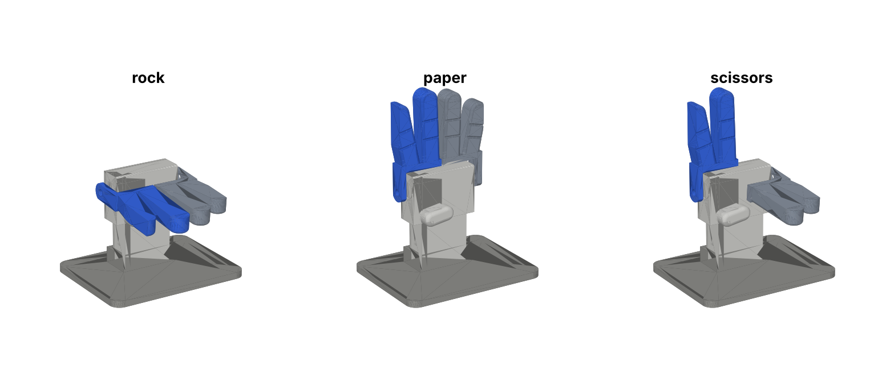
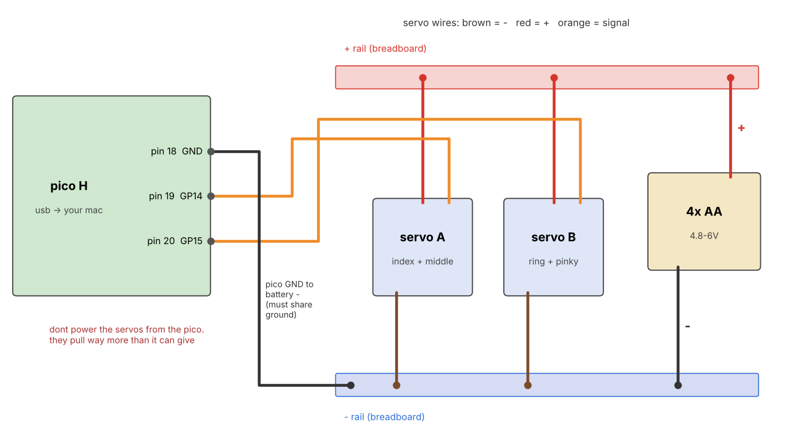

# lilrps irl

the physical hand. 2 servos, 4 fingers, a pico. the mac still does all the seeing, the pico just moves fingers



servo A swings index + middle, servo B swings ring + pinky. both curled = rock, both up = paper, A up B curled = scissors. each finger pair is bolted straight onto its servo horn, so the servo shaft IS the knuckle. no strings, no linkages

## parts (~$53 from core electronics)

[one click cart](https://core-electronics.com.au/cart/link?items=CE08702%3A1%2CSER0039%3A3%2CCE05102%3A1%2CCE08574%3A1%2CADA3859%3A1)

| what | qty |
|---|---|
| raspberry pi pico H (headers already soldered) | 1 |
| 9g metal gear micro servo (mg90 size) | 3 (2 + a spare) |
| 400 point breadboard | 1 |
| male to male jumper wires | 1 pack |
| 4xAA battery holder with jumper wires | 1 |

plus 4 AA batteries, superglue, and a micro usb cable that actually does data. screws come with the servos

## print

everything in `stl/` is already rotated the right way. PLA, 0.2mm layers, 3 walls, 15% infill, **no supports**

1. **fit_test.stl first** (~20 min). slide a servo in from the back, it should go in snug with its tabs in the slot. drop a horn into the little coupon. too tight or too loose? change `CL` (or the servo numbers) at the top of `cad.py` and run it again
2. then palm, cover, yoke_a, yoke_b, thumb, base

## wire



the battery holder has no switch, pull a lead out of the rail to turn it off

## flash the pico

1. hold BOOTSEL, plug the pico in, drag the micropython .uf2 for "RPI_PICO" (from micropython.org/download) onto the drive that pops up
2. then:

```
uv pip install -p .venv mpremote pyserial
.venv/bin/mpremote cp irl/pico/main.py :main.py + reset
```

## build + calibrate

1. superglue a single arm horn into the pocket on each yoke, arm pointing up the bracket
2. slide both servos into the palm from the back, cables down into the wrist
3. run `.venv/bin/python irl/calibrate.py`. it starts both servos at 90. while its waiting, push each yoke onto its servo with the fingers about halfway curled, and screw the horn screw in through the hole
4. follow the prompts: type angles till the fingers point straight up (open), then straight at you (closed). **dont curl past straight at you**, past ~105 degrees the index hits the thumb. it saves `irl/config.json` and does a little demo
5. back cover on with 4 of the spare servo screws, glue the thumb on the front, push the wrist into the base and run the cables out the slot

## play

```
.venv/bin/python play.py --hand
```

during the countdown the hand sits half curled so it never has to do a full swing. at +0.3s it starts moving to whatever the early guess says. when the referee locks in ur move it goes to the counter, and if the guess was right its already there

## files

- `cad.py` the whole hand as code (cadquery). every size is a number at the top
- `check.py` sweeps both brackets through -5 to 105 degrees and checks nothing hits anything
- `render.py`, `wiring.py` make the pictures
- `link.py` the mac side, `pico/main.py` the pico side. protocol is just lines like `A95 B10`
- `calibrate.py` finds ur open/closed angles

editing the cad needs `pip install cadquery`, nothing else here does
